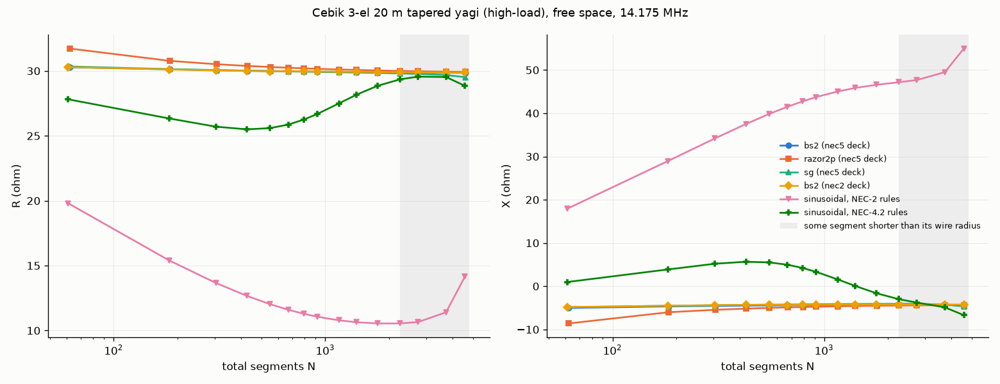

# Verdict: Cebik's 3-element 20 m yagi with tapered elements

**Added:** 2026-11-23 by Steve Burns, KK7KNB, from a segment-convergence
study of momwire's engines. **Status: verdict published** (nec2c, NEC-5 and
momwire; licensed NEC-4.2 not yet run).

## The antenna

L. B. Cebik, W4RNL, "I Want to Build a 3-Element Yagi", part 3: the 20 m
"high-load" design, with its telescoping aluminium elements, in free space.

- Full element lengths: reflector 447.3 in, driven element 421.6 in,
  director 393.3 in.
- Spacing: reflector to driven element 80.0 in, driven element to director
  106.0 in.
- Taper, from the boom outward (the article's Fig. 23 schedule): 48 in of
  1.25 in OD (one 96 in centre tube), then 24 in of 1.0 in, 20 in of
  0.875 in, 42 in of 0.75 in, 20 in of 0.625 in, and a 0.5 in tip to the
  element's end. Eleven wires per element.
- Fed at the centre of the driven element's centre tube.
- **Frequency 14.175 MHz.** This is an assumption: the article's page names
  no frequency; 14.175 MHz is the 20 m design frequency of Cebik's taper
  study.

`tapered-yagi.nec` is the NEC-2-dialect deck at the base mesh (each
section about 20 in a segment, the centre tube odd). `study/mkyagi.py`
writes it from the dimensions above.

## The ladder

Every GW count is multiplied by an odd m and the source re-centred, as for
the tapered dipole. NEC-5 and the NEC-5-dialect momwire engines read the
same structure written in NEC-5's dialect, with the source at the centre
tube's middle knot (one more segment on the fed wire). All values are
Zin in Ω at 14.175 MHz.

| m | N (NEC-2 deck) | nec2c | momwire sinusoidal, NEC-2 rules | momwire sinusoidal, NEC-4.2 rules | NEC-5 | momwire razor2p | momwire bs2 |
| --- | --- | --- | --- | --- | --- | --- | --- |
| 1 | 61 | 19.81 + j17.87 | 19.80 + j17.90 | 27.81 + j0.97 | 31.73 − j8.61 | 31.72 − j8.61 | 30.28 − j5.02 |
| 3 | 183 | 15.41 + j28.93 | 15.40 + j28.96 | 26.34 + j3.88 | 30.78 − j6.02 | 30.78 − j6.02 | 30.12 − j4.66 |
| 5 | 305 | 13.67 + j34.15 | 13.66 + j34.19 | 25.70 + j5.20 | 30.52 − j5.45 | 30.52 − j5.45 | 30.05 − j4.55 |
| 9 | 549 | 12.04 + j39.78 | 12.03 + j39.82 | 25.59 + j5.51 | 30.30 − j5.01 | 30.30 − j5.01 | 29.99 − j4.45 |
| 15 | 915 | 11.08 + j43.69 | 11.07 + j43.73 | 26.68 + j3.33 | 30.16 − j4.73 | 30.16 − j4.75 | 29.95 − j4.39 |
| 29 | 1769 | 10.55 + j46.54 | 10.55 + j46.58 | 28.86 − j1.64 | 30.03 − j4.51 | 30.03 − j4.52 | 29.90 − j4.34 |

From m = 37 on, some segment is shorter than its wire's radius (the
0.625 in sections), outside the thin-wire kernels' range, so those rungs
(to m = 75 for momwire) are in the figure but not used for the call.

## The verdict

**≈ 29.8 − j4.3 Ω**, on two independent formulations that converge to it:

- momwire bs2 extrapolates to 29.83 − j4.31 Ω (it is within 1 % of that
  from 428 segments, and within |ΔΓ| 0.01 from 184).
- NEC-5, and its momwire twin razor2p, approach it from above more slowly
  (razor2p extrapolates to 29.85 − j4.27 Ω, 0.05 Ω from bs2; within 1 %
  only from about 1,770 segments). NEC-5 itself reads 30.03 − j4.51 Ω at
  m = 29 and is still falling towards it.
- It agrees with Cebik's own description of the design, a feed impedance
  of about 30 Ω.

**Raw NEC-2 is wrong here, and refining the mesh makes it worse.** nec2c
reads 19.8 + j17.9 Ω at the base mesh and 10.6 + j46.5 Ω at m = 29, about
55 Ω and |ΔΓ| 0.9 from the answer. It is the stepped-radius defect the
tapered-dipole verdict shows, much larger on a yagi: the taper steps sit in
every element, and the parasitic elements' currents carry the error into
the feed. momwire's NEC-2 twin (sinusoidal with NEC-2's rules) reproduces
nec2c to about 0.04 Ω at every rung.

**Equal segment lengths across the steps do not help.** The usual NEC-2
advice for a stepped element is to keep segments the same length on both
sides of each diameter step. With every segment in an element about the
same length (`study/equal_segments.py`), nec2c moves away from the answer
just as the odd-multiple ladder does:

| segment length | N | nec2c |
| --- | --- | --- |
| 20 in | 61 | 19.81 + j17.87 |
| 8 in | 153 | 16.24 + j26.49 |
| 4 in | 315 | 13.51 + j34.41 |
| 2 in | 633 | 11.70 + j40.94 |
| 1.2 in | 1059 | 10.87 + j44.50 |

So there is no segment count at which raw NEC-2 reaches the answer here.

## The Leeson correction

The usual fix for NEC-2 and stepped elements is not a mesh rule. It is
D. B. Leeson's (W6QHS, now W6NL) substitute element, from *Physical Design
of Yagi Antennas* (ARRL, 1992), chapter 8. EZNEC applies it as its
"stepped diameter correction". This section applies it to this yagi and
asks whether NEC-2 then reaches the answer.

**The method.** Each tapered element is replaced by one uniform cylinder,
with its own diameter and length, chosen to have nearly the same
self-impedance near resonance. Working on one half-element:

1. Average the logarithm of the tube radii, each weighted by its tube's
   length. This gives a first-order equivalent radius.
2. Use that radius to get the average characteristic impedance of a
   cylinder of the element's length.
3. Assume a sinusoidal, resonant current. Sum each step's correction to the
   cylinder's resonant self-reactance and to its slope with frequency. Each
   step is weighted by how far its tubes sit from the mean radius, and by
   the sine and cosine of the electrical distance from the centre to its
   ends.
4. The tapered element's reactance at the half-wave length gives its
   resonance shift. That shift sets the corrected length, and the reactance
   slope sets the corrected diameter.

The frequency drops out, because the method works at the element's own
resonance. It is valid for a straight, symmetric element fed or loaded only
at its centre, and within about 15 % of resonance. All three elements here
are within 7 %.

Leeson's book was not available for this study. The equations come from
the open transcription in fnec-rust (`crates/nec_solver/src/taper.rs`,
commit `1c5a8d6e`, citing Eqs 8-44 to 8-59 and Tables 8-2/8-3).
`study/leeson.py check` runs the implementation against three sets of
published numbers:

| case | l′ (this) | d′ (this) | l′ (published) | d′ (published) |
| --- | --- | --- | --- | --- |
| Leeson's worked example (as transcribed) | 95.70 | 0.5935 | 95.70 | 0.594 |
| Cebik Fig. 16 top (3lyg3, EZNEC) | 98.57 | 0.6307 | 98.58 | 0.631 |
| Cebik Fig. 16 middle | 98.67 | 0.5985 | 98.67 | 0.598 |
| Cebik Fig. 16 bottom | 98.38 | 0.7385 | 98.39 | 0.739 |
| Cebik amod10, one step far out | 201.41 | 0.9651 | 201.45 | 0.966 |
| Cebik amod10, one step near centre | 201.70 | 0.7930 | 201.661 | 0.792 |
| Cebik amod10, two steps | 201.52 | 0.8894 | 201.49 | 0.889 |
| Cebik amod10, extreme taper | 201.73 | 0.8978 | 201.63 | 0.895 |

All values are half-lengths and diameters in inches. Cebik's numbers are
the substitutes EZNEC reported (3lyg3's Fig. 16 table, and "Tapering to
Perfection", Antenna Modeling #10). The 10 m cases agree to 0.01 in. The
14 MHz dipoles agree to 0.1 in and 0.003 in. That small residual may come
from details of EZNEC's implementation; it is far too small to matter
below.

**The corrected elements.** The method has no single reference diameter.
Each element gets its own:

| element | physical length (in) | Leeson length (in) | Leeson OD (in) | length-weighted log-mean OD (in) |
| --- | --- | --- | --- | --- |
| reflector | 447.3 | 428.20 | 0.7823 | 0.7588 |
| driven element | 421.6 | 403.59 | 0.8055 | 0.7784 |
| director | 393.3 | 376.72 | 0.8339 | 0.8036 |

`study/leeson.nec` is the corrected yagi: three uniform wires with the same
spacing, fed at the driven element's centre, 14.175 MHz, 51 segments per
element. `study/leeson.py deck N` writes it at N segments per element.

**The ladder.** Zin is in Ω. Δ is measured from the verdict, 29.8 − j4.3 Ω.
The bs2 and razor2p columns run the same rungs in NEC-5's dialect: the
source sits at the driven element's middle knot, which adds one segment to
that wire.

| segments per element | nec2c | Δ (Ω) | abs ΔΓ (50 Ω) | momwire bs2 | momwire razor2p |
| --- | --- | --- | --- | --- | --- |
| 11 | 30.08 − j0.26 | 4.05 | 0.063 | 30.03 − j0.20 | |
| 21 | 29.64 + j0.55 | 4.85 | 0.076 | 29.80 + j0.22 | 31.54 − j4.13 |
| 31 | 29.46 + j0.89 | 5.20 | 0.082 | 29.69 + j0.44 | |
| 51 | 29.27 + j1.25 | 5.57 | 0.088 | 29.56 + j0.68 | 30.52 − j1.47 |
| 81 | 29.14 + j1.51 | 5.84 | 0.092 | 29.47 + j0.87 | |
| 121 | 29.05 + j1.68 | 6.03 | 0.095 | 29.39 + j1.01 | 29.91 − j0.12 |
| 201 | 28.98 + j1.83 | 6.19 | 0.098 | 29.31 + j1.16 | |
| 301 | 28.93 + j1.91 | 6.27 | 0.099 | 29.26 + j1.26 | 29.53 + j0.69 |
| 601 | | | | 29.23 + j1.32 | 29.36 + j1.05 |
| 901 | | | | 29.21 + j1.35 | |

**NEC-2 now converges, but to the wrong antenna.** The radius steps are
gone, so nec2c converges. Its rungs flatten out near 28.9 + j1.9 Ω, within
about 0.6 Ω of what bs2 and razor2p converge to on the same corrected
deck, about 29.2 + j1.4 Ω. Leeson's correction does exactly what it
promises: NEC-2 now solves the equivalent antenna correctly.

**The equivalent is not the tapered antenna.** It converges about 5.7 Ω
from the tapered yagi's answer (|ΔΓ| ≈ 0.09 at 50 Ω), almost all of it in
reactance (+1.4 against −4.3 Ω). The correction takes NEC-2 from 55 Ω off
and getting worse with refinement to about 6 Ω off and stable, but it does
not reach 29.8 − j4.3 Ω. The coarse rungs land closer (4.1 Ω at 11
segments per element) only because they have not converged yet.

The residual is the substitution itself, element by element. In bs2, each
element alone (the tapered one at m = 9 against its Leeson cylinder at 301
segments) gives:

| element alone | tapered (bs2) | Leeson equivalent (bs2) |
| --- | --- | --- |
| reflector | 99.51 + j73.45 | 93.38 + j78.89 |
| driven element | 78.75 + j9.10 | 75.48 + j13.72 |
| director | 61.24 − j56.70 | 59.82 − j53.74 |

Each substitute reads 3 to 5.5 Ω more inductive than its tapered element, as
if electrically a little long, with lower R. This matches Cebik's own
figures: his Leeson-corrected driven elements read 2.3 to 3.8 Ω lower in R
than MININEC, and the AK#896 dipole demo found the corrected R about 4 Ω
low with X close. The correction is calibrated to the
MININEC of its day and assumes a sinusoidal current. On a yagi those
single-element errors combine through the coupling into the 5.7 Ω seen at
the feed.

**Cebik's own corrected results** cannot be compared here: 3lyg3 gives no
corrected Zin for the 20 m high-load yagi, only "about 30 Ohms" for the
feed, which both the tapered answer and the Leeson equivalent satisfy.

**momwire's NEC-4.2-rule sinusoidal does not converge either.** It sits
5–11 Ω off on the usable rungs (25.6 + j5.5 Ω at m = 9), and crosses the
answer only once segments are about as short as the radius. Licensed
NEC-4.2 has not been run on this deck yet; until it is, this row is
momwire's NEC-4.2-rule engine, not NEC-4.2.

**The radius steps are the cause.** The same yagi with every tube at one
radius (9.525 mm, `study/uniform-control.nec`, detuned to about
10.9 + j55 Ω) brings both sinusoidal rule sets to within 0.2–1.4 Ω of bs2.
NEC-2's extended kernel does not fix the tapered case (still about 55 Ω
off).

## Reproducing

- `study/mkyagi.py` writes `tapered-yagi.nec`; `study/mkuniform.py` the
  uniform-radius control.
- `study/ladder.py` writes the odd-multiple rungs (the source re-centred to
  (s − 1)m + (m + 1)/2, as in this repo's other ladders).
- nec2c 1.3.1 and NEC-5 read the rung decks verbatim. NEC-5 printouts are
  End-User Reports (LLNL-CODE-746721); only their numbers appear here.
- momwire 0.97.1: each engine through its own launcher (`momwire-nec2c-sinusoidal`,
  `momwire-nec42-sinusoidal`, `momwire-nec5-razor2p`, `momwire-nec5-bs2`).
- `study/leeson.py`: `check` (the method against its published cases),
  `table` (the corrected elements), `deck N` (writes `study/leeson.nec` at
  N = 51), `ladder` (the nec2c column). The bs2 and razor2p columns are the
  same decks after `antennaknobs export --dialect nec5`, run through
  `momwire-nec5-bs2` and `momwire-nec5-razor2p`.
